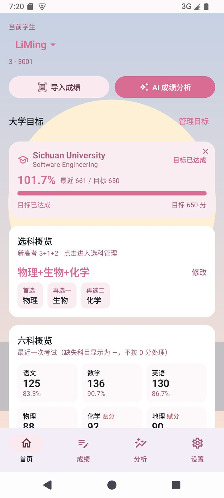
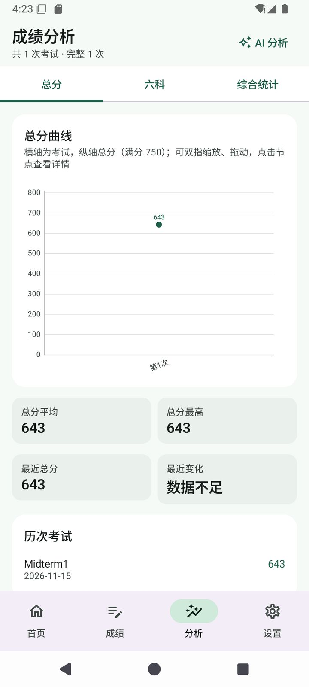
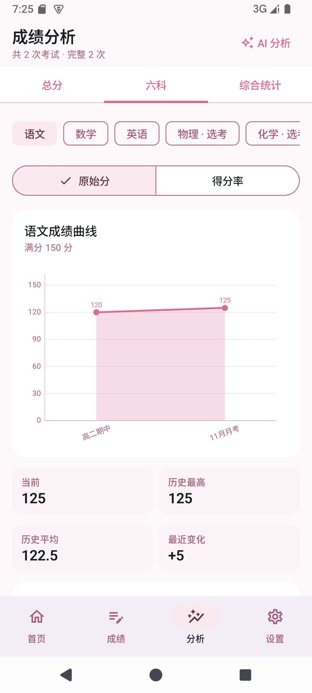
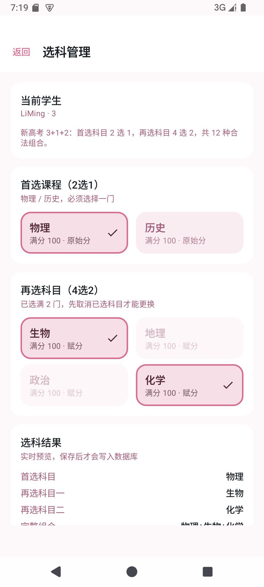
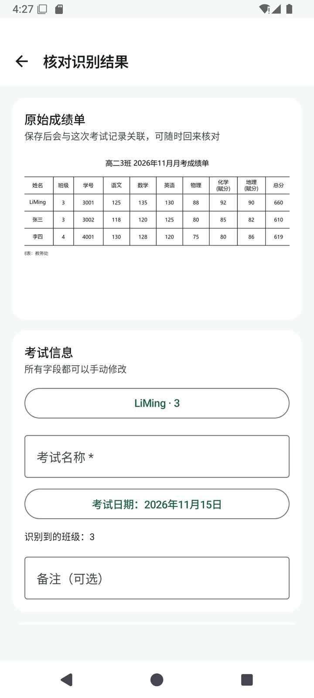
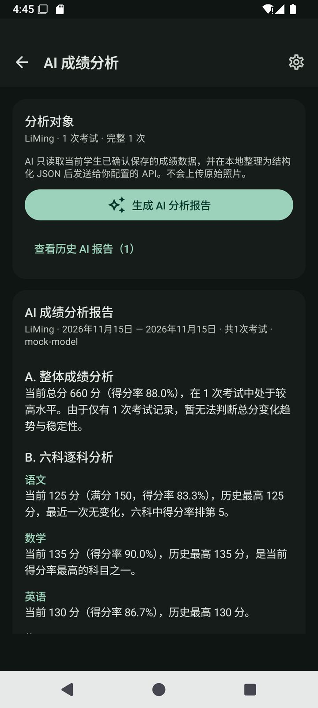
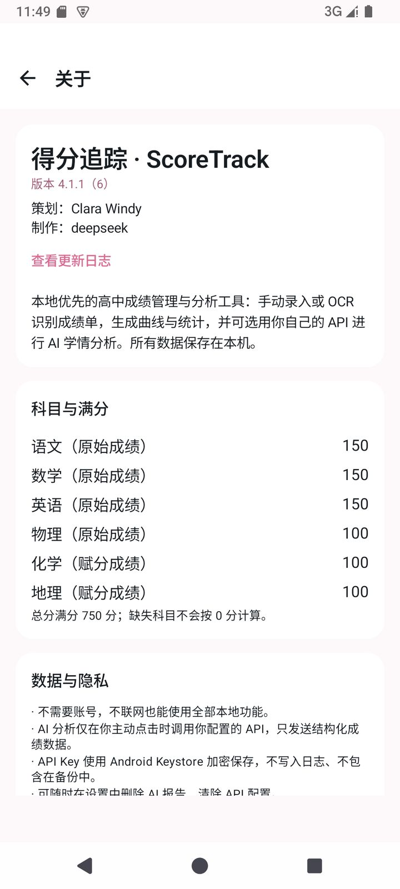

# 得分追踪 · ScoreTrack

<p>
  
  
  
  
  
  
</p>

原生 Android 的高中成绩管理与分析工具：**手动录入或 OCR 识别成绩单**，自动生成总分/单科曲线、得分率标准化分析，并结合**用户自己配置的 AI 接口**生成学情分析报告。全部数据保存在本机，不需要账号，也不会上传原始照片。

> 面向场景：一名或多名高中生的历次考试追踪。支持新高考 **3+1+2 选科**（首选物理/历史，再选生物/地理/政治/化学，共 12 种组合）。

---

## 功能一览

| 模块 | 能力 |
| --- | --- |
| 学生管理 | 多学生档案（姓名 / 班级 / 学号）、一键切换当前学生；同名学生在创建与导入时用班级/学号区分，**绝不自动合并** |
| 成绩录入 | 手动录入、编辑、删除；考试名称完全自定义、允许重名；实时总分与满分校验 |
| 成绩单导入 | 相册多选、相机拍照、文件管理器：**JPG / PNG / WEBP / PDF / XLSX / XLS / CSV**；支持多图与多页 PDF |
| 表格 OCR | ML Kit 中文识别 + 自研表格结构还原：表格线检测、合并单元格、表头定位、按姓名/班级/学号匹配目标学生行、低置信度标红 |
| 图像预处理 | EXIF 方向纠正、倾斜校正、对比度/去噪增强、透视矫正；单科支持「局部区域重新识别」 |
| 复核确认 | 学生、班级、考试名、日期、各科成绩（含识别原文与置信度）全部可改，**点击确认才写库** |
| 原始成绩单留档 | 可选保存原图/PDF 并与考试记录关联，随时打开核对；删除文件不影响已保存成绩 |
| 可视化分析 | 总分曲线（满分 750、显示分值、点击看详情、缩放、横屏）、六科独立曲线、原始分/得分率双视图、综合统计面板 |
| AI 分析 | 任意 OpenAI 兼容接口（Base URL / Key / Model / 温度 / 最大 Token 均可配置）；报告含整体、六科逐科、优势薄弱、变化归因、学习建议；历史报告保留数据快照，可复制、导出 PDF |
| 选科 3+1+2 | 12 种合法组合、按学生隔离、非法组合不可保存、重启保留；改选不删历史成绩；录入与统计高亮选考科目；AI 分析围绕选考三科 |
| 个性化 | 7 套主题色 + 自定义 HEX（深浅色各自派生 Material 3 配色）、主页壁纸（缩放/拖动/透明度）、大学目标卡（含校徽）、主页模块开关与排序 |
| 备份导出 | JSON 完整备份/恢复（版本校验、合并去重）、ZIP（含原始成绩单）、CSV 成绩表、分析 PDF、AI 报告 PDF |

## 界面截图

<table>
  <tr>
    <td align="center"><br><sub>首页：目标卡 / 选科 / 六科概览</sub></td>
    <td align="center"><br><sub>总分曲线（满分 750）</sub></td>
    <td align="center"><br><sub>单科曲线与得分率对比</sub></td>
  </tr>
  <tr>
    <td align="center"><br><sub>3+1+2 选科（实时校验）</sub></td>
    <td align="center"><br><sub>OCR 结果复核（逐项可改）</sub></td>
    <td align="center"><br><sub>AI 学情分析报告</sub></td>
  </tr>
</table>

<p align="center"><br><sub>关于页：版本、署名与隐私说明</sub></p>

## 下载安装

1. 打开本仓库的 **Releases** 页面，下载最新 `ScoreTrack-x.y.z.apk`。
2. 传到手机上点击安装（需在系统设置中允许「安装未知来源应用」）。
3. 要求 **Android 13（API 33）及以上**；首次启动无需登录，直接创建学生档案。

> 升级：从 v2 / v3 / v4 起同一签名，可直接覆盖安装，学生、考试、成绩、原始成绩单、AI 报告、主题、壁纸、目标卡、选科全部保留；首次启动自动执行 Room 迁移，并在迁移前把数据库备份到应用私有目录。

## 从源码构建

### 环境

| 组件 | 版本 |
| --- | --- |
| JDK | 17（Temurin 17.0.21 验证通过） |
| Gradle | 8.9（仓库内含 wrapper） |
| Android SDK | platform 35、build-tools 35.0.0 |
| AGP / Kotlin / KSP | 8.7.3 / 2.0.21 / 2.0.21-1.0.28 |

### 命令

```bash
# 1) 指向本机 Android SDK
echo "sdk.dir=/path/to/Android/sdk" > local.properties

# 2) 单元测试（41 项）
./gradlew :app:testDebugUnitTest

# 3) 构建
./gradlew :app:assembleDebug     # 调试包
./gradlew :app:assembleRelease   # 正式包（需自备签名配置，见下）
```

release 构建需要在 `app/build.gradle.kts` 的 `signingConfigs.release` 中填入**你自己的** keystore；仓库不包含任何签名密钥。

> Windows 提示：项目路径含非 ASCII 字符时，AGP 需要 `gradle.properties` 中 `android.overridePathCheck=true`（已配置）；此时 JVM 单测需用 ASCII 盘符映射（如 `subst X: <项目路径>` 后从 `X:` 运行），否则会报测试类 `ClassNotFoundException`。这是 Gradle 8.9 在 Windows 上的路径问题，与代码无关。

## 技术栈与架构

Kotlin · Jetpack Compose · Material 3 · MVVM · Room · Kotlin Coroutines / Flow · ML Kit 中文 OCR · MPAndroidChart · Coil · OkHttp（原生 HttpURLConnection 封装）· Android Keystore。

```
app/src/main/java/com/scoretrack/
├── MainActivity.kt                # 唯一 Activity，仅承载 Compose 根
├── ScoreTrackApp.kt               # Application + AppContainer（手写依赖容器）
├── core/                          # 领域模型：Subject、ExamRecord、Student、ColorHex
├── data/
│   ├── db/                        # Room：Entities / Daos / ScoreTrackDatabase / 迁移
│   ├── repo/                      # StudentRepository、ExamRepository、DocumentStore…
│   ├── goal/  theme/  wallpaper/  # 目标卡（含校徽）、主题、壁纸仓库
│   └── settings/                  # SettingsRepository、SecretStore（Keystore 加密）
├── domain/                        # AnalyticsEngine（统计/趋势）、选科规则、目标进度
├── ocr/                           # BitmapOps、GridDetector、TextTableBuilder、
│                                  # PerspectiveCorrector、OcrEngine、SheetReconstructor、ImportPipeline
├── parser/                        # CsvParser、XlsxParser（自写 OOXML）、XlsParser(jxl)、PdfPages
├── ai/                            # OpenAiClient、PromptBuilder、AiAnalysisService
├── ui/                            # AppNavigation、MainViewModel、screens/*、components/*、chart/*
├── report/                        # PdfExporter（PdfDocument 排版）
└── backup/                        # BackupService、BackupArchive（ZIP）
```

分层约定：UI 只通过 `MainViewModel` 调用仓库与领域服务；OCR、解析、分析、AI、备份之间仅通过数据模型（`ExamRecord`、`SheetParseResult`、`AnalysisResult`、`AiSnapshot`）交互，业务逻辑不进入 Activity。

## 数据库

Room 12 张表，`version = 4`，代码位于 `app/src/main/java/com/scoretrack/data/db/`：

- 基础：`students`、`subjects`（9 门）、`exams`、`scores`、`source_documents`、`ai_reports`、`app_settings`
- v2：`theme_settings`、`wallpaper_settings`、`goal_cards`、`dashboard_cards`
- v3：`subject_selections`
- v4：`goal_cards.logoPath`（`MIGRATION_3_4`）

要点：

- 迁移 `MIGRATION_1_2` / `MIGRATION_2_3` / `MIGRATION_3_4` 均为增量，禁止破坏性迁移；升级前自动备份，升级后校验记录数并弹窗展示变化
- 外键：`exams.studentId → students.id`（CASCADE）、`scores.examId → exams.id`（CASCADE）
- 删除原始成绩单前先把 `exams.sourceDocumentId` 置空，历史成绩不受影响
- `students / documents / ai_reports` 使用 `@Upsert`（INSERT ... ON CONFLICT DO UPDATE），避免 SQLite `REPLACE` 触发级联删除

完整字段说明见 [docs/DATABASE.md](docs/DATABASE.md)。

## 隐私与安全

- 不需要账号，不联网也能使用全部本地功能；数据只在本机数据库和文件目录中。
- OCR 使用 ML Kit **离线**中文模型，原始照片不会离开设备。
- AI 分析仅在用户点击「生成」时发起请求，只发送**结构化成绩 JSON**（学生姓名/班级、考试名称与日期、各科成绩、总分、本地统计、选科组合），**不上传原始照片**；首次使用前有明确的隐私确认。
- API Key 用 **Android Keystore（AES-256-GCM）** 加密保存，界面默认掩码，不写入日志，备份文件不含 Key。
- 报告与原始成绩单均可删除；删除原图不影响已确认的成绩数据。

## AI 接口配置

设置 →「AI 分析设置」：

| 字段 | 说明 |
| --- | --- |
| Base URL | 默认 `https://api.deepseek.com`，可填任意 OpenAI 兼容地址（含自建网关 / 局域网服务） |
| API Key | 由用户自行填写，不随仓库分发 |
| Model | 默认 `deepseek-chat`，可改为 `gpt-4o-mini`、`qwen-plus` 等 |
| Temperature | 可选，0–2 |
| 最大输出 Token | 可选，默认 2048 |

「测试连接」会真实发起请求，并区分密钥错误、模型不可用、网络错误、限流、服务端错误等状态；接口不兼容时显示具体错误，不会假装成功。详见 [docs/API.md](docs/API.md)。

## 测试与验证

- 单元测试：**41 项全部通过**（OCR 表格解析、统计与趋势、CSV 解析、颜色系统、目标进度、选科规则）
- 真机回归：Android 15 / API 35 模拟器上完成 OCR、导入导出、AI、主题、壁纸、目标卡、选科、校徽全流程验证
- 升级验证：使用 **旧版本真实数据库** 做覆盖安装（`adb install -r`，从未卸载），逐项核对迁移前后的数据条数

详细的测试条目、包体校验与已知限制见 [docs/VERIFICATION.md](docs/VERIFICATION.md)。

## 已知限制

1. 仅在 Android 15（API 35）模拟器验证，未覆盖所有 Android 13 / 14 机型的差异。
2. release 未开启 R8 混淆（避免 ML Kit / 图表库反射问题），APK 约 90 MB，主要来自离线 OCR 模型。
3. 手写体、强反光、低分辨率成绩单识别率有限；复核页会标红低置信度字段，必须人工确认，不会猜分。
4. 选考总分只是 3 门之和（满分 300），不代表任何省份的投档或赋分规则；省份赋分通过 `ElectiveScoreRule` 接口扩展。
5. 班级/年级排名、多学生对比、云同步尚未实现，数据模型已预留扩展位。

## 文档

| 文档 | 内容 |
| --- | --- |
| [docs/USAGE.md](docs/USAGE.md) | 使用说明：录入、导入、分析、选科、主题、目标卡、备份 |
| [docs/DATABASE.md](docs/DATABASE.md) | 数据库结构、外键与迁移策略 |
| [docs/API.md](docs/API.md) | AI 接口配置、错误码、发送的数据样例 |
| [docs/UPGRADE.md](docs/UPGRADE.md) | 版本升级与数据库迁移、覆盖安装实测 |
| [docs/SELECTION.md](docs/SELECTION.md) | 选科功能说明与测试报告 |
| [docs/VERIFICATION.md](docs/VERIFICATION.md) | 测试与验证记录 |
| [docs/CHANGELOG.md](docs/CHANGELOG.md) | 版本更新日志 |

## 许可证与致谢

- 许可证：[MIT](LICENSE)
- 策划：Clara Windy　制作：deepseek
- 开源组件：Jetpack Compose、Room、ML Kit、MPAndroidChart、Coil、jxl 等，遵循各自许可证

> 本项目是个人学习与自用工具，不构成任何升学或录取建议；AI 生成的结论仅供参考。
